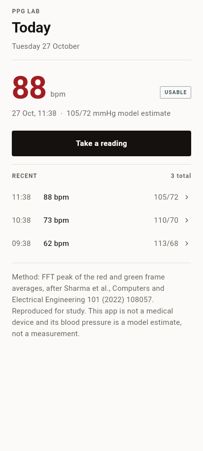
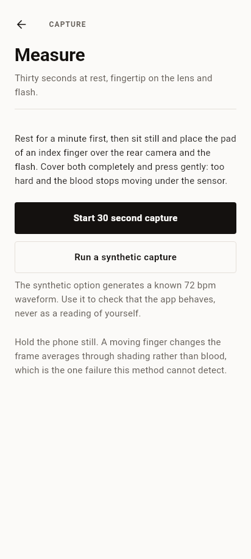
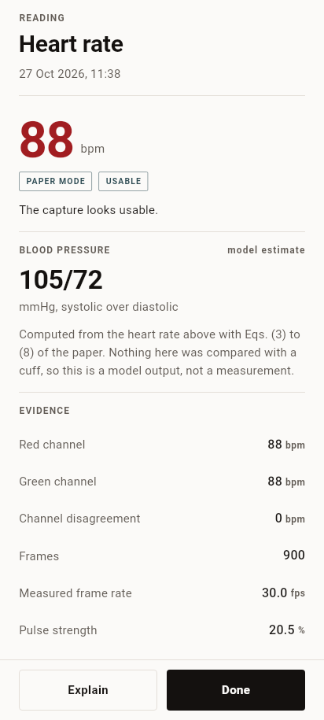
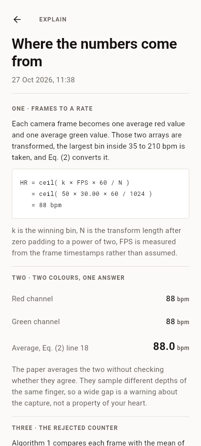
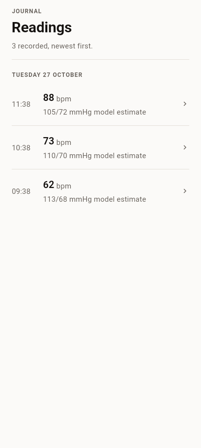
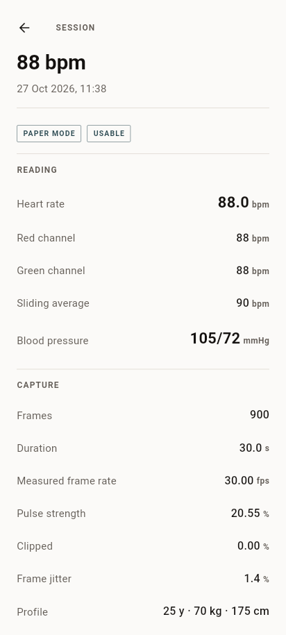
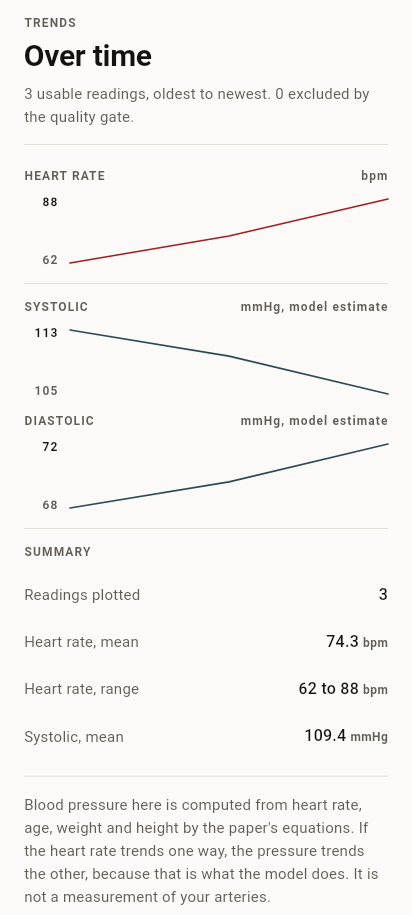
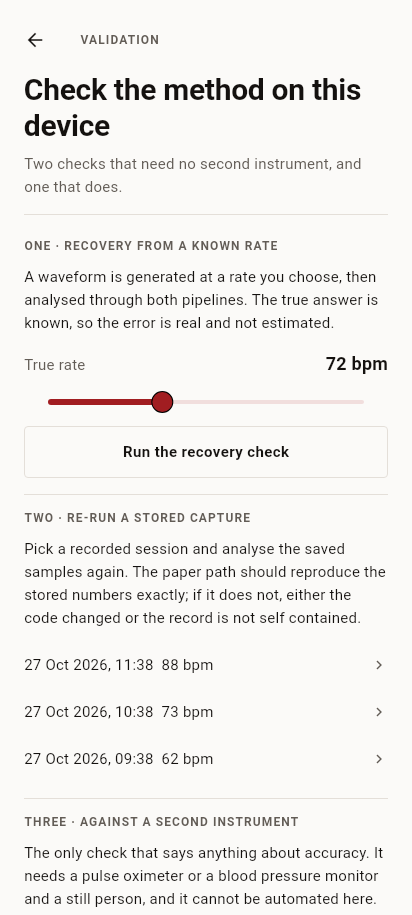
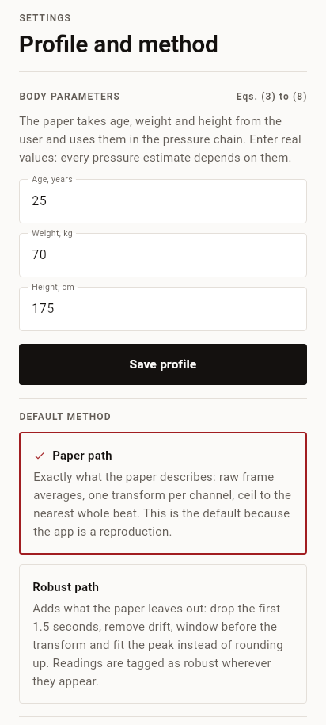

# The app, screen by screen

How PPG Lab turns the paper into something a person can hold, and where each
of the paper's ideas ends up in the interface. The concepts themselves are in
[the paper walkthrough](journal-walkthrough.md); the reasoning behind each
interface decision is in [DESIGN.md](../DESIGN.md).

---

## The thirty second loop

A first run, in order.

1. Open the app. The Today tab shows no readings, one sentence about what a
   capture needs, and a button.
2. Tap **Take a reading**. The Measure screen explains finger placement, then
   offers **Start 30 second capture**.
3. The camera opens, the torch comes on, and the screen turns into an
   instrument: a countdown, a drawing trace of the red channel, a smaller
   trace of the green channel, pulse strength, and the measured frame rate.
4. At thirty seconds the capture stops by itself. The transform runs and the
   Result screen replaces the capture.
5. The Result screen shows a heart rate, a verdict, a blood pressure labelled
   as a model estimate, and the evidence: both channels, their disagreement,
   the frame count, the measured rate, and the answer the abandoned counting
   method would have given.
6. **Why these numbers** opens Explain, which writes out Eq. (2) and
   Eqs. (3) to (8) with this capture's values substituted.
7. The session is already saved. It appears in the Journal, in Trends once
   there are two of them, and in Validation where it can be re-analysed.

Nothing in that loop needs a network, an account, or a second device.

---

## Screens

The pictures below are written by `tool/preview/screens_test.dart` when it
renders the widget tree, so each one is the real layout with fixture data,
and re-running the test is enough to bring them back in step with the code.
They are not device screenshots: this checkout has no phone attached.

### Today (`lib/ui/home_screen.dart`)



Two jobs: say what state you are in, and get you into a capture.

- The last reading, at the size a reading deserves, with when it happened and
  the two pressures underneath.
- A quality tag: usable, fair or unusable. The word carries the meaning; the
  colour only reinforces it.
- One primary button, **Take a reading**. One way to the Journal.
- A warning block if the profile in Settings is invalid, because an invalid
  profile means the pressure chain cannot run.
- A closing paragraph naming the paper and saying the app is not a medical
  device. It is on the first screen rather than buried in Settings on
  purpose.

### Measure (`lib/ui/measure_screen.dart`)



The only screen that talks to hardware, and the only one with a state machine.

| State | What is on screen |
|---|---|
| idle | Placement instructions, **Start**, and a clearly labelled synthetic option |
| preparing | "Starting the camera and the torch", with a progress line |
| capturing | Countdown, both traces, live pulse strength, live frame rate, **Stop and analyse now** |
| analysing | One line about what is being computed |
| failed | The reason in plain words, **Try again**, and the synthetic option |
| ready | Navigates straight to the Result screen |

The live trace is not decoration. The paper's method takes the mean of every
frame, so a finger sliding across the lens shows up as a wandering trace, and
the user can correct it while there is still time. The live pulse strength
turns that into a number.

Two things are deliberately possible here. **Stop and analyse now** keeps a
short capture instead of throwing it away, because a ten second capture still
produces a number, it just has a coarser bin grid (see the resolution table in
the paper walkthrough). And the **synthetic capture** generates a known
waveform, which is how the app can be demonstrated or checked on a device
with no working torch.

### Result (`lib/ui/result_screen.dart`)



Five blocks, in the order a person asks the questions.

1. **The heart rate**, 64 point tabular numerals.
2. **The verdict**: a tag and one sentence. When the quality gate failed, the
   sentence says so plainly: "Treat the number as unreliable and retake it."
3. **Blood pressure**, with the words "model estimate" next to the heading and
   a paragraph explaining that no cuff was involved. If the chain refused, the
   block explains why instead of showing a number.
4. **Evidence**: red bpm, green bpm, their disagreement, frames, measured
   frame rate, pulse strength, clipping. Values that indicate a problem are
   shown in the warning colour.
5. **The rejected counter**: how many peaks the sliding average found and what
   rate that implies, with a sentence about why the paper abandoned it.

### Explain (`lib/ui/explain_screen.dart`)



Four numbered sections and a closing caveat.

- **One, frames to a rate**: Eq. (2), then the same equation with this
  capture's bin index, measured frame rate and transform length filled in.
- **Two, two colours, one answer**: both channel rates and the average the
  paper takes, with a note that a wide gap is a capture warning, not biology.
- **Three, the rejected counter**: the peak count and the multiplication.
- **Four, rate to pressure**: all six equations, substituted, ending in the two
  pressures.
- **What this cannot tell you**: rhythm, arrhythmia, calibration, and the fact
  that the pressure never met a cuff.

The bin index shown here is read from a re-run of the stored signal, not
reconstructed from the rounded heart rate, so it is the number the analysis
actually used.

### Journal (`lib/ui/journal_screen.dart`)



Every session, newest first, grouped by day with a small date heading. Each
row: time, heart rate, blood pressure or "no blood pressure", and a tag when
the capture was not clean. Unusable captures are kept and marked rather than
hidden, because a record of failures is part of an honest log.

### Session detail (`lib/ui/session_screen.dart`)



One session, in full: the reading, the capture metrics, the stored signal on
demand, and a re-run of both pipelines side by side. The re-run is the point.
It proves the stored record is self contained: the same samples produce the
same numbers, and the robust path produces a different, explainable number.

Two pipelines compared on one capture:

| | Paper | Robust |
|---|---|---|
| Heart rate | from the raw spectrum with `ceil` | from a windowed, detrended, resampled spectrum with a fitted peak |
| Typical difference | a beat or two | within half a bin of the paper path |

Deletion lives here, behind a confirmation, and it removes the raw samples
too.

### Trends (`lib/ui/trends_screen.dart`)



Three sparklines: heart rate, systolic, diastolic. Hand drawn, no chart
package. The highest and lowest value of each series sit in a narrow left
gutter, against the top and bottom of the line, so the shape can be placed
without reading the newest point as the minimum.

Only captures that passed the quality gate are plotted, and the header says
how many were excluded. Plotting an unusable capture between two clean ones
would make the line mean nothing.

The closing paragraph is the one that matters: because the pressures are
computed from the heart rate, the pressure lines are not independent
evidence. They move the way the model says they move, which is the opposite
of what a real person does during exercise.

### Validation (`lib/ui/validation_screen.dart`)



Three checks, in increasing order of what they can prove.

1. **Recovery from a known rate.** A waveform is generated at a rate you pick,
   then analysed through both pipelines. The true answer is known, so the
   error is measured, not estimated. This checks the arithmetic end to end.
2. **Re-run a stored capture.** Pick a session, re-analyse the saved samples.
   The paper path should reproduce the stored numbers exactly. If it does not,
   either the code changed or the record is not self contained.
3. **Against a second instrument.** Cannot be automated. The screen describes
   the protocol and points at [validation.md](validation.md).

Each result block prints the size of one bin at the measured frame rate, so a
difference smaller than that is visibly the grid rather than the method.

### Settings (`lib/ui/settings_screen.dart`)



- **Body parameters**: age, weight and height, validated before saving, with
  the ranges and the reason stated.
- **Default method**: paper or robust, each with a description of what it
  changes. Paper is the default.
- **Cross check**: whether the rejected counter is shown on results.
- **Appearance**: follow the system, light, or dark.
- **Data**: delete everything, with a confirmation that names the count.
- **About**: the full citation, the not a medical device paragraph, and the
  build line.

---

## Where the paper lives in the code

| Paper element | Code | Surface |
|---|---|---|
| 30 s capture, rear camera, torch | `android/.../PpgCameraPlugin.kt` | Measure |
| YUV420SP to RGB, per frame averages | `PpgCameraPlugin.analyse` | Measure traces |
| Measured frame rate (Alg. 2 line 13) | `SignalQuality.measuredFps` | Measure, Result, Session |
| Alg. 1 sliding average | `countPeaksSliding`, `heartRateFromPeaks` | Result, Explain |
| Eq. (2) FFT peak | `findPeakBin`, `PeakBin.bpm` | Result, Explain |
| Red and green average (Alg. 2 line 18) | `heartRateFromRgb` | Result, Explain |
| Band limit at 35 bpm | `hrMinBpm`, `hrMaxBpm` | Explain |
| Eqs. (3) to (8) | `estimateBloodPressure` | Result, Explain, Trends |
| Database of readings | Drift `Sessions` table | Journal, Trends, Validation |

The paper's own words appear in the app only where they explain a choice:
the rejected counter is called "the method the paper rejected", and the
pressure block says "model estimate" every time it appears.

---

## What the app does not do

- No account, no sync, no analytics, no network permission.
- No blood pressure accuracy claim, because the paper has none.
- No blood oxygen estimate, although the paper's introduction discusses why
  smartphone oximetry is unreliable. That discussion is not a method in the
  paper, so it is not a feature here.
- No background capture. The camera stops when the screen is left.
- No medical advice. The copy says what was measured and what it cannot
  support, and stops there.

---

## Build and run

```
./check.sh          # analyse, unit tests, fixture comparison
flutter run         # with a device attached
flutter build apk   # signed with the debug key by default
```

The APK in `docs/ci-and-install.md` is the same build run on GitHub Actions,
with the toolchain pinned. Use that one for the phone: it is reproducible from
the repository and needs no local Android SDK.

`check.sh` also regenerates the Python fixtures and fails if the Dart port
drifts from them.
